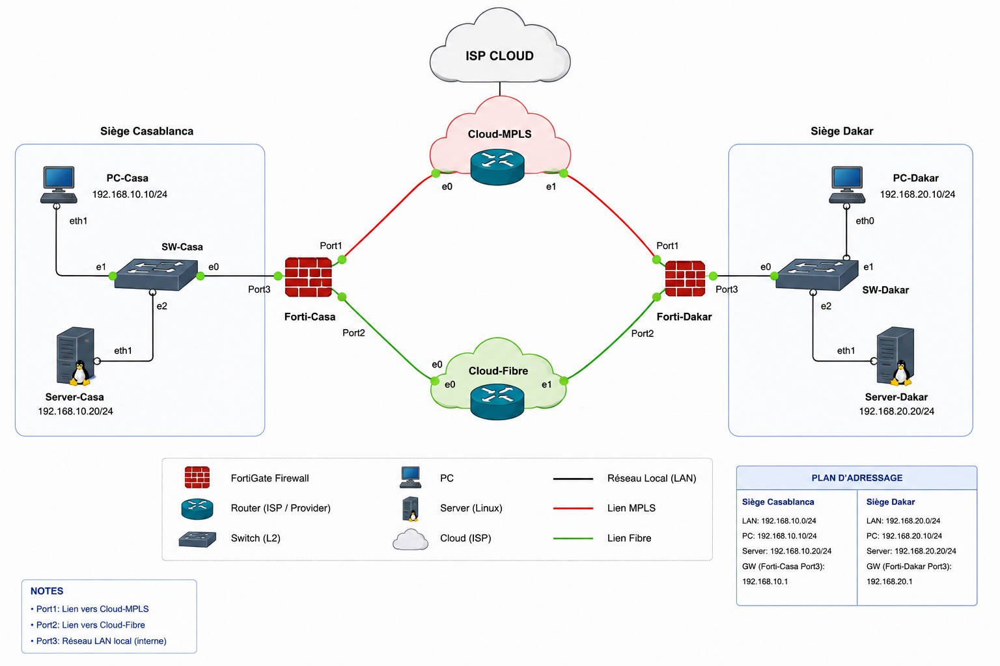

# Forti SD-WAN — Casablanca ⇄ Dakar



A GNS3 lab demonstrating a **Fortinet SD-WAN** architecture between two
sites (Casablanca and Dakar), connected through two simulated transport
links (MPLS and Fibre) and two IPsec tunnels, with dynamic path
selection based on latency.

## Overview

This project reproduces a realistic dual-WAN branch office scenario:
two FortiGate firewalls sit behind two independent transport networks
(an MPLS-like link and a Fibre/Internet-like link, each emulated by a
VyOS router), connected to each other through a pair of site-to-site
IPsec VPN tunnels. FortiOS SD-WAN then monitors both tunnels with
health-checks and automatically steers traffic over the best-performing
path — falling back to the secondary link within seconds if the
primary one degrades or goes down.

**Goals of the lab:**

- Build a two-site FortiGate topology from scratch in GNS3 (interfaces,
  routing, VPN, firewall policies).
- Configure SD-WAN zones, health-checks and a latency-based steering
  rule (`Best Quality` / priority mode with `link-cost-factor latency`).
- Validate transport connectivity, IPsec tunnel state, and SD-WAN
  member selection.
- Simulate WAN link quality (latency/loss) with `tc netem` on the VyOS
  routers and observe SD-WAN failover/failback behavior in real time.
- Turn the whole configuration into idempotent, reusable shell scripts
  instead of manual click-ops or a static Word document.

## Architecture

| Site       | LAN              | PC                | Server            | GW (port3)   |
| ---------- | ---------------- | ----------------- | ------------------ | ------------ |
| Casablanca | 192.168.10.0/24  | 192.168.10.10/24  | 192.168.10.20/24   | 192.168.10.1 |
| Dakar      | 192.168.20.0/24  | 192.168.20.10/24  | 192.168.20.20/24   | 192.168.20.1 |

| FortiGate interface | Role  | Forti-Casa      | Forti-Dakar     |
| -------------------- | ----- | --------------- | --------------- |
| port1                | MPLS  | 10.100.0.2/24   | 10.100.1.2/24   |
| port2                | FIBRE | 10.200.0.2/24   | 10.200.1.2/24   |
| port3                | LAN   | 192.168.10.1/24 | 192.168.20.1/24 |

Two VyOS routers emulate the WAN networks (Cloud-MPLS and Cloud-Fibre)
that sit between the two FortiGate firewalls.

**IPsec tunnels:**

| Tunnel     | Underlay | Interface | Encryption      |
| ---------- | -------- | --------- | ---------------- |
| VPN-MPLS   | MPLS     | port1     | AES256-SHA256    |
| VPN-FIBRE  | Fibre    | port2     | AES256-SHA256    |

**SD-WAN rule** (`LAN_TO_DAKAR` on Casa / `LAN_TO_CASA` on Dakar):
priority mode, members `MPLS` (priority 1) and `FIBRE` (priority 2),
health-checked, steering criterion: **latency**.

## Tech stack

- **FortiOS 7.6.7** (FortiGate VM64-KVM) — firewall, VPN, SD-WAN
- **VyOS** — WAN link emulation (Cloud-MPLS, Cloud-Fibre)
- **GNS3** — lab orchestration / virtual topology
- **Linux (VPCS/servers)** — end hosts for connectivity testing
- **Bash** — deployment and test automation (`Config/`, `Tests/`)

## Repository structure

```
Forti-SDWAN/
├── Topologie.png     Network diagram
├── Config/            Shell scripts to deploy the FortiGate/VyOS configuration
├── Forti-Lab/         GNS3 project (lab topology)
├── Screenshots/       Screenshots of the validated configuration
└── Tests/             Shell scripts for testing/validation
```

> The original Word draft (`SDWAN.docx`) used while building the
> configuration is intentionally **not** versioned in this repo: its
> content was reviewed, corrected, and turned into shell scripts under
> `Config/` and `Tests/` (see [Config/README.md](Config/README.md) for
> the full list of corrections applied).

## Prerequisites

- GNS3 with a FortiGate VM64-KVM appliance image and a VyOS appliance
  image imported.
- SSH management access enabled on each FortiGate/VyOS (`port3` /
  management interface).
- `ssh` client and `bash` available on the machine running the
  scripts.

## Quick start

```bash
cd Config
export VPN_PSK='YourStrongPreSharedKey!'
./run-all.sh <forticasa-ip> <fortidakar-ip> admin

cd ../Tests
./run-all-tests.sh <forticasa-ip> <fortidakar-ip> admin
```

Each script can also be run individually — check the header of every
`.sh` file for its exact usage. A typical deployment order is:

1. `01-interfaces-forticasa.sh` / `02-interfaces-fortidakar.sh` — hostname + interfaces
2. `03-cloud-routers-vyos.sh` — WAN emulation routers
3. `04-static-routes.sh` — default routes over the transport links
4. `05-vpn-ipsec-forticasa.sh` / `06-vpn-ipsec-fortidakar.sh` — IPsec tunnels
5. `07-static-routes-vpn.sh` — routes to the remote LAN through the tunnels
6. `08-firewall-policies-forticasa.sh` / `09-firewall-policies-fortidakar.sh` — LAN ⇄ VPN policies
7. `10-sdwan-forticasa.sh` / `11-sdwan-fortidakar.sh` — SD-WAN zone, health-checks, steering rule

## Testing

The `Tests/` folder validates the deployment end to end:

- `test-transport-connectivity.sh` — checks that the underlay MPLS and
  Fibre links are reachable between the two sites, before any VPN.
- `test-vpn-tunnels.sh` — checks IKE/IPsec SA state for both tunnels.
- `test-sdwan-service.sh` — checks the SD-WAN rule, health-check
  status, and the currently selected member.
- `test-sdwan-failover.sh` — automates a failover scenario: brings
  `port1` (MPLS) down, verifies FIBRE takes over, then restores MPLS
  and verifies failback.
- `test-wan-quality-simulation.sh` — applies/clears `tc netem`
  latency and loss profiles on the VyOS routers to exercise the
  latency-based steering criterion (MPLS: 5ms/0.05% loss, Fibre:
  25ms/0.5% loss).

Run them all with `Tests/run-all-tests.sh <forticasa-ip> <fortidakar-ip>`.

## Security

- The IPsec pre-shared key is **never** hardcoded: it is read from the
  `VPN_PSK` environment variable.
- Never commit real secrets (PSK, admin passwords) to this repository.
  Use a local `.env` file (ignored via `.gitignore`) or a secrets
  manager for real deployments.
- The original draft used the deprecated `des-sha256` IPsec proposal;
  all scripts in this repo use `aes256-sha256` instead (see
  [Config/README.md](Config/README.md) for details).

## Roadmap / possible improvements

- Add BGP or OSPF over the tunnels instead of static routes, for
  easier scaling to more sites.
- Add a third WAN member (e.g. LTE/4G) to demonstrate 3-way SD-WAN
  steering.
- Add Terraform/Ansible automation as an alternative to the raw SSH
  shell scripts.
- Add SLA-based (packet loss / jitter) steering rules alongside the
  latency-based one.

---

## 👤 Author

**Yasser** — Network & Security Engineer

🔗 GitHub: [@Yasser-02G](https://github.com/Yasser-02G)

Feel free to open an _issue_ or a _pull request_ if you have suggestions to improve this project.

---

## ⚠️ Disclaimer

This lab is built for **academic and research purposes** only, using legally obtained trial licenses from Fortinet. All configurations target an intentionally vulnerable/controlled GNS3 environment. Do not use these configurations on production networks without proper security review.
